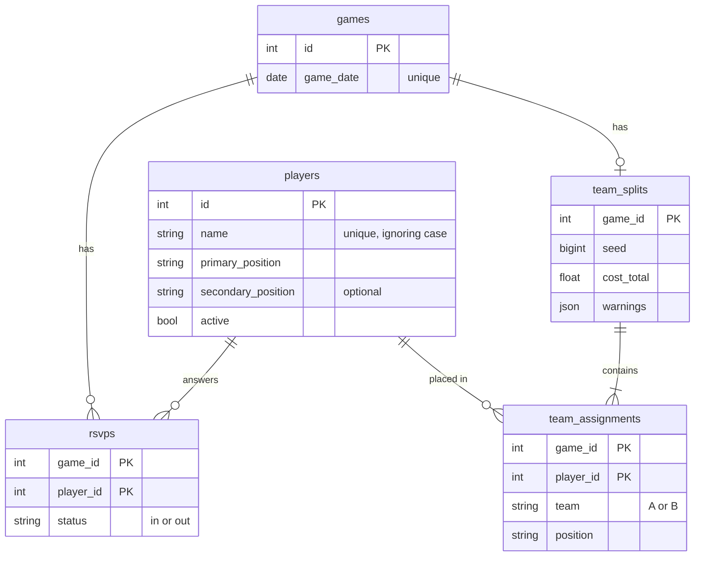

# Database

PostgreSQL tables, defined with SQLAlchemy.

| File | Purpose |
| --- | --- |
| [`models.py`](models.py) | The tables and their constraints. |
| [`session.py`](session.py) | Connection setup. |

## Tables

## Design choices

- **The database enforces the important rules.** Check constraints limit positions,
  statuses and teams to valid values, and an index on `lower(name)` makes names
  unique ignoring case. A bug in the app can't store bad data.
- **Each game keeps one split.** Making teams again replaces it. The stored `seed`
  and the players who were in are enough to reproduce a split with the same code
  and weights.
- **Removing a player hides them.** `active` turns false, so past games keep their
  names. Adding the same name again brings them back.
- **Positions are text with a check constraint**, not a PostgreSQL enum, because
  changing a check constraint in a migration is simpler.

## Changing a table

Edit `models.py`, then add a migration as described in
[`migrations/README.md`](../../migrations/README.md).
