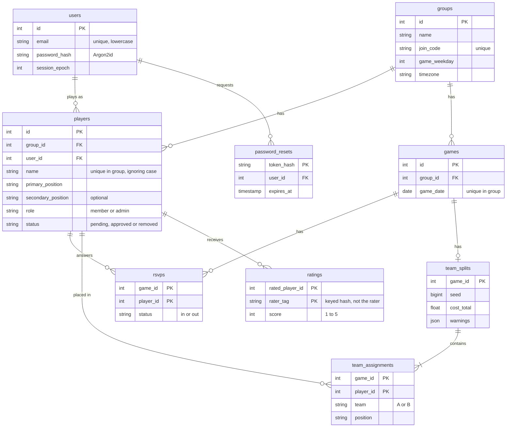

# Database

PostgreSQL tables, defined with SQLAlchemy.

| File | Purpose |
| --- | --- |
| [`models.py`](models.py) | The tables and their constraints. |
| [`session.py`](session.py) | Connection setup. |

## Tables

`rate_limits` stands apart. See [`app/ratelimit.py`](../ratelimit.py).

## Design choices

- **The database enforces the important rules.** Check constraints limit positions,
  statuses, roles and scores to valid values. A bug in the app can't store bad data.
- **`players` connects an account to a group**, along with that person's name, positions,
  role and approval status there.
- **Removing a player keeps their row**, with `status = 'removed'`, so past games keep
  their names. Their name becomes free, through a partial unique index, and their ratings
  are deleted. Deleting an account removes everything, including from past teams.
- **`ratings` has no rater column or timestamp.** See
  [`app/ratings/README.md`](../ratings/README.md).
- **Each game keeps one split.** Making teams again replaces it.

## Changing a table

Edit `models.py`, then add a migration as described in
[`migrations/README.md`](../../migrations/README.md).
