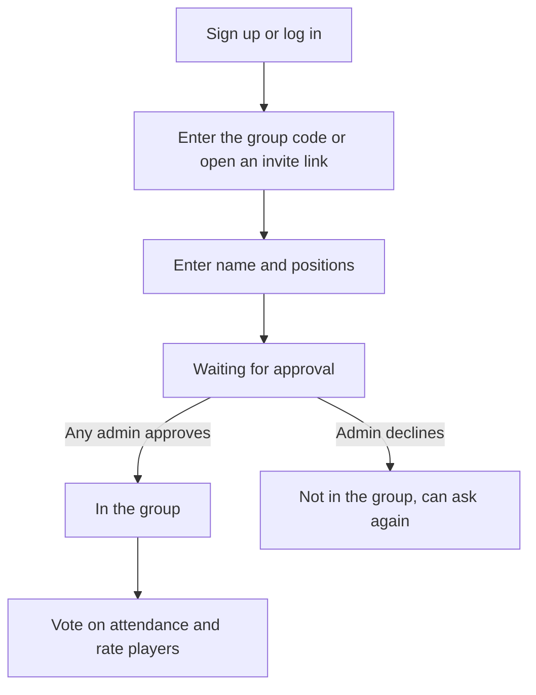

# Groups

Creating pickup groups, joining them, and what admins can do, in
[`service.py`](service.py).

## How someone joins

A code alone gets nobody in. Until they're approved, a person can see only the group's
name, and can't see its players, games, teams or ratings.

## Roles

| Can do | Member | Admin |
| --- | --- | --- |
| Vote on their own attendance | Yes | Yes |
| Rate other players | Yes | Yes |
| See teams, players and the invite link | Yes | Yes |
| Approve or decline requests | | Yes |
| Make and reshuffle teams | | Yes |
| See average ratings | | Yes |
| Make or remove admins, remove players | | Yes |
| Change settings, replace the code, delete the group | | Yes |

Admins do their work on the **Configure group** page, reached from **My groups**. Everyone
has **Invite and players**, with the invite link, the players and their own details.

Whoever creates a group is its first admin. A group always keeps at least one admin:
the last one can't leave, be removed or delete their account until someone else is an
admin, or the group is deleted.

## Design choices

- **A player is one account in one group.** The same person can use a different name in
  each group. Names are unique within a group, ignoring case.
- **Group codes are long and random:** 12 characters, or about 59 bits, without
  characters that are easy to confuse. Dashes, spaces and capitalization don't matter.
- **Replacing a code doesn't remove anyone.** It only stops the old code and invite link.
- **Limits:** 10 wrong codes per visitor in 15 minutes, 5 new groups per visitor a day,
  500 new groups across the site a day, and 100 players per group.

## Known gaps

- **Admins aren't told about requests.** A request appears on the group page, but nothing
  notifies them. Email notifications could be added once email is set up.
- **Abandoned groups stay forever.** Nothing cleans them up.
